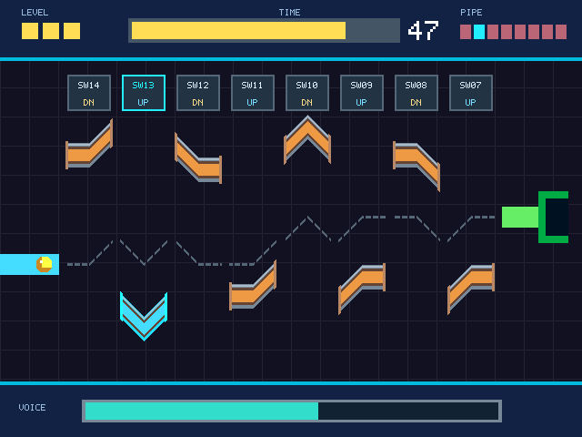

# Lab 3：Digital Voice Recorder

Nexys A7 數位錄音機。使用板載 PDM 麥克風錄音，將資料存入 DDR2，並由音訊輸出播放。`integrated` 分支結合正常／倒轉播放、暫停、停止、2～8 倍快放、1/2～1/8 倍慢放、七段顯示器與七格音量條。

## 聲控管道遊戲（`game` 分支）

將 Nexys A7 的 VGA 接到支援 640×480 VGA 的外接螢幕。遊戲使用板載麥克風的即時音量；安靜時管子不動，發聲越大，每 50 ms 移動越多（1～7 像素）。只有目前選取的管段會動。管段接近正確高度時會吸附並變成綠色；全部接通後球自動滾進右側洞口。三關分別有 **4 段／40 秒、6 段／50 秒、8 段／60 秒**。每段可形成彎頭或 S 形，三關的球起點／洞口高度分別是 264／212、208／260、290／238 像素。遊戲音量條門檻降為原錄音音量條的一半，錄音功能原本的門檻不變。



畫面預覽：[DCLAB GROUP11 首頁](docs/game_page0.png) · [操作說明](docs/game_page1.png) · [關卡預覽](docs/game_page2.png)。

切換流程：**SW15 撥下**顯示 DCLAB GROUP11 首頁；**SW15 撥上**顯示操作說明；**第一次按 BTNU** 進入關卡預覽（時間不減）；**第二次按 BTNU** 才開始倒數與移動。過關按 BTNU 進下一關預覽，再按一次開始該關。

| 操作 | 遊戲功能 |
| --- | --- |
| `SW15` | 撥下顯示 DCLAB GROUP11 首頁並使用原錄音機功能；撥上進入遊戲說明 |
| `SW14`～`SW7` | 由左至右第 1～8 段的方向；撥上（1）往上、撥下（0）往下。每段上方標有 SW 號碼與 `UP`／`DN`；只需設定本關出現的 4／6／8 段 |
| `BTNL`／`BTNR` | 選取左邊／右邊的管段；只會在本關可移動的管段之間切換 |
| `BTNU` | 說明頁進入預覽、預覽頁開始計時；過關後進下一關預覽、逾時後重新預覽；全破後回說明頁 |
| `BTND` | 返回第一關說明頁 |
| `BTNC` | 重設整個 FPGA 系統 |

七段顯示器格式為 `L1  40P1`：關卡 1、剩餘 40 秒、目前選取第 1 段。VGA 左上 `LEVEL` 三格表示關卡，中間 `TIME` 長條及兩位數表示剩餘秒數，右上 `PIPE` 八格表示各段狀態：青色是選取、橘色待調整、綠色已對齊、暗色尚未用到。下方 `VOICE` 長條表示即時音量。管段和上方標牌比前版縮小，每段標示 `SW14`～`SW07` 與 `UP`／`DN`。板上 `LED0`～`LED7` 表示已接通的管段，`LED8` 表示遊戲模式，`LED9`～`LED15` 顯示遊戲音量。

第一次玩第一關：將 `SW15` 撥上，閱讀說明並按兩次 `BTNU`；保持選取 `P1`，將 `SW14` 撥下，對麥克風發聲直到第一段變綠；按 `BTNR` 選取 `P2`，依灰色虛線目標位置決定將 `SW13` 撥上或撥下，再發聲對齊。對其餘兩段重複操作。全部接通後球自動滾進洞。畫面中的灰色虛線標出各段應對齊的路徑。

遊戲模式會停止正在錄製或播放的音訊；切回 `SW15=0` 後，原錄音機的按鍵和 `SW[4:0]` 設定恢復。遊戲與錄音機共用音量計，遊戲中量測的是即時麥克風。球會沿已接通的固定路徑滾動。VGA 使用 100 MHz 時鐘上的 25 MHz 像素 enable。

從現有 Vivado 專案建置遊戲 bitstream：

```powershell
C:\AMDDesignTools\2026.1\Vivado\bin\vivado.bat -mode batch -source build_game.tcl -log C:\DCLAB3_vivado\DCLAB3\game_build.log -journal C:\DCLAB3_vivado\DCLAB3\game_build.jou
```

輸出為 `C:\DCLAB3_vivado\DCLAB3\NEXYS_A7_game.bit`。使用 Vivado Hardware Manager 的 **Program Device** 選擇此 `.bit` 檔燒錄。遊戲畫面與按鍵已經過模擬；VGA 顯示相容性和實際麥克風手感仍需用實體板與螢幕確認。

遊戲控制模擬可執行：

```powershell
iverilog -g2012 -s Game_Controller_tb -o "$env:TEMP\Game_Controller_tb.vvp" Game_Level_Config.sv Game_Controller.sv sim/Game_Controller_tb.sv
vvp "$env:TEMP\Game_Controller_tb.vvp"
```

VGA 同步時序與遊戲七段顯示器可執行：

```powershell
iverilog -g2012 -s Game_Display_tb -o "$env:TEMP\Game_Display_tb.vvp" Game_Level_Config.sv Game_VGA.sv Game_SevenSegment.sv sim/Game_Display_tb.sv
vvp "$env:TEMP\Game_Display_tb.vvp"
```

## 目前進度（2026-11-13）

- 錄音、DDR2 儲存與正常播放已完成。音訊時鐘為 3.125 MHz，錄音上限為 16 秒（`MAX_WORDS = 781_250` 個 64-bit 字）。
- 快放每個輸出週期消耗 `n` 個原始 PDM 位元，使用累加器維持輸出 `1` 的密度；慢放把每個原始位元重複 `n` 次。播放位置可跨越 64-bit 字邊界，播放中可切換倍率。
- 已加入播放前預讀，以及下一個 64-bit 字的緩衝。暫停會保留播放進度，停止後可從頭重播。
- 倒轉方向由按下錄音鍵當下的 `SW4` 決定，直到下一次錄音或重設都不改變。倒轉播放由 DDR2 最後一個字往前讀，每個字由 bit0 往 bit63 輸出；可搭配變速與暫停。
- 音量條使用 `volume-LED` 分支已在板上測過的 PDM 音量計。`LED9～LED15` 顯示七格音量，`LED16` 的紅色顯示已鎖定的倒轉方向。
- 使用者已分別在實體板上測過音量條與播放功能；整合版本仍需上板驗證。
- Vivado 2026.1 已完成整合版的綜合、布局繞線與 bitstream 產生。可燒錄檔案為 `C:\DCLAB3_vivado\DCLAB3\NEXYS_A7_integrated.bit`；Vivado 專案位於 `C:\DCLAB3_vivado\DCLAB3\DCLAB3.xpr`。

## 板上操作

| 控制 | 功能 |
| --- | --- |
| `BTNC` | 重設系統 |
| `BTNU` | 開始錄音；錄音時再按一次，於目前 64-bit 字收滿後停止 |
| `BTNR` | 從頭播放；播放中按下為暫停，暫停中按下為繼續 |
| `BTND` | 停止錄音或播放 |
| `SW[3:0]` | 選擇播放速度，播放中可切換 |
| `SW4` | **按下 `BTNU` 開始錄音時**鎖定方向：0 正常、1 倒轉；之後切換 SW4 不影響這段錄音的播放 |

速度設定：`SW[2:0] + 1` 是倍率數字 `n`。`SW[3]=0` 時為 `n×`，`SW[3]=1` 時為 `1/n×`。兩種方向的 `n=1` 都是正常速度。

| `SW[3:0]` | 播放速度 |
| --- | --- |
| `0000` 或 `1000` | 1× |
| `0001`～`0111` | 2×～8× |
| `1001`～`1111` | 1/2×～1/8× |

`LED16` 紅色顯示已鎖定的方向（亮為倒轉）。`LED9～LED15` 為音量條；`LED[8:5]` 顯示同步後的四位速度設定。`LED0` 為錄音中、`LED1` 為播放中、`LED2` 為暫停、`LED3` 為已有錄音、`LED4` 為錄音溢位或播放資料供應不足。`LED4` 會保持亮起，直到重設或開始新錄音。停止後再次按 `BTNR`，會依同一方向從頭重播；要改方向需重新錄音。

### LED9～LED15 音量條

錄音時顯示麥克風 PDM 音量，播放時顯示送往音訊輸出的 PDM 音量；停止、暫停與播放前預讀時全暗。由 LED9 起往 LED15 依序增加亮燈數。音量計每 64 個 PDM 位元計算一次密度，扣除緩慢變動的直流偏移後取絕對值，再平滑成相對振幅。這不是校準過的聲壓分貝值。門檻為 `0.5、0.75、1、1.5、2、3、4`，定義在 `Pdm_Volume_Meter.sv`。

在現有 Vivado 專案重新產生 bitstream：

```powershell
C:\AMDDesignTools\2026.1\Vivado\bin\vivado.bat -mode batch -source build_integrated.tcl
```

腳本會先備份現有 bitstream，加入音量計與跨時脈約束檔，執行綜合及實作；只有最終 setup／hold 餘裕都非負時，才把 bitstream 複製到上述可燒錄檔案。專案需保有既有的 `ila_0` IP。

## 七段顯示器（bonus）

八位數由左至右分成三位狀態、兩位原錄音位置秒數、三位速度。正常播放時秒數隨消耗的原始音訊位元遞增；倒轉播放時從錄音總長倒數至 `00`。快放、慢放與暫停仍顯示錄音內容中的位置，而不是實際播放耗時。錄音最多顯示 `16` 秒；停止時顯示錄音總長。倒轉方向可由 LED16 紅燈判斷。

| 顯示 | 意義 |
| --- | --- |
| `rEC05---` | 正在錄音，已錄 5 秒 |
| `PLY05F04` | 播放到原錄音第 5 秒，4× 快放 |
| `PLY12n01` 且 LED16 紅燈亮 | 倒轉播放中，原錄音位置約剩 12 秒 |
| `PAU05S04` | 暫停在原錄音第 5 秒，速度設定 1/4× |
| `PLY05n01` | 正常速度播放 |
| `StP12---` | 已停止，錄音總長 12 秒 |
| `Err12   ` | 錄音溢位或播放資料供應不足；空白位不點亮 |

`F02`～`F08` 代表 2×～8×，`S02`～`S08` 代表 1/2×～1/8×，`n01` 代表 1×。七段顯示器上的字母為近似字型。小數點 `DP` 保持關閉。

## 程式結構

| 檔案 | 用途 |
| --- | --- |
| `NEXYS_A7.sv` | 板上頂層：時鐘、按鍵、開關同步、LED、麥克風、音訊與 DDR2 接線 |
| `Pdm_Volume_Meter.sv` | 將 PDM 資料轉為七格相對音量條 |
| `Game_Level_Config.sv` | 三關共用的球起點／洞口、管道彎曲形狀與目標位置 |
| `Game_Controller.sv` | 選段、聲控位移、三關倒數、管道對齊及球滾動狀態機 |
| `Game_VGA.sv` | 640×480 遊戲畫面、VGA 同步與 25 MHz 像素 enable |
| `Game_SevenSegment.sv` | 遊戲關卡、剩餘時間與選取管段的七段顯示 |
| `build_game.tcl` | 將遊戲模組加入 Vivado 專案並產生遊戲 bitstream |
| `cdc_timing.xdc` | 限制已握手的音訊時脈至 DDR2 使用者時脈資料路徑延遲 |
| `build_integrated.tcl` | 備份舊 bitstream、建置整合版並檢查最終時序 |
| `Top.sv` | 錄音／播放狀態機、方向鎖定、64-bit 資料緩衝、DDR2 請求、變速與原錄音秒數計算 |
| `ddr2_interface.sv` | Top 與 MIG 之間的 DDR2 交易及跨時鐘域同步 |
| `Debounce.sv` | 按鍵同步、去彈跳與按下脈波 |
| `Seven_Segment_Display.sv` | 八位七段顯示器的狀態排版、字型與掃描 |
| `Nexys-A7-100T-Master.xdc`、`mig.ucf` | 板上腳位與 DDR2 相關約束 |
| `sim/Top_speed_tb.sv` | 使用交易級 DDR2 模型驗證錄音及所有速度模式 |
| `sim/Seven_Segment_Display_tb.sv` | 驗證八位掃描、狀態、秒數及速度字型 |
| `sim/Pdm_Volume_Meter_tb.sv` | 驗證音量門檻、衰減、清空與直流偏移抑制 |
| `sim/Top_vivado_tb.sv` | 使用 Vivado IP 與 DDR2 模型的整合測試平台 |

## 已做的驗證

- `sim/Top_speed_tb.sv` 已通過正常與倒轉各 16 種 `SW[3:0]` 設定，並覆蓋跨字邊界、單一字錄音、暫停／繼續、播放中切換速度、倒轉秒數，以及錄音後或播放中切換 SW4 不影響已鎖定方向。可在專案根目錄以 Icarus Verilog 重跑：

  ```powershell
  iverilog -g2012 -s Top_speed_tb -o "$env:TEMP\Top_speed_tb.vvp" Top.sv sim/Top_speed_tb.sv
  vvp "$env:TEMP\Top_speed_tb.vvp"
  ```

- `sim/Seven_Segment_Display_tb.sv` 已通過八位實體掃描輸出與各種狀態字型檢查：

  ```powershell
  iverilog -g2012 -s Seven_Segment_Display_tb -o "$env:TEMP\Seven_Segment_Display_tb.vvp" Seven_Segment_Display.sv sim/Seven_Segment_Display_tb.sv
  vvp "$env:TEMP\Seven_Segment_Display_tb.vvp"
  ```

- `sim/Pdm_Volume_Meter_tb.sv` 驗證靜音、音量門檻、衰減、停止時清空及固定直流偏移抑制：

  ```powershell
  iverilog -g2012 -s Pdm_Volume_Meter_tb -o "$env:TEMP\Pdm_Volume_Meter_tb.vvp" Pdm_Volume_Meter.sv sim/Pdm_Volume_Meter_tb.sv
  vvp "$env:TEMP\Pdm_Volume_Meter_tb.vvp"
  ```

- 2026-11-13 的整合版 routed timing report 顯示 WNS `+0.787 ns`、WHS `+0.036 ns`、TNS/THS 均為 `0`；bitstream 前 DRC 為 `0 errors`。速度／倒轉、音量計與七段顯示器三組 Icarus 模擬皆通過。

- 2026-11-09 的新版 routed timing report 顯示 WNS `+0.682 ns`、WHS `+0.019 ns`、TNS/THS 均為 `0`；bitstream 前 DRC 為 `0 errors`。時鐘方法學警告仍如後述，正餘裕只代表目前約束下的結果。

- 2026-11-04 的 routed timing report 顯示 WNS `+0.589 ns`、WHS `+0.019 ns`、TNS/THS 均為 `0`；路由完成，bitstream 前的 DRC 為 `0 errors`。

## 已知警告與後續工作

1. **跨時脈資料路徑。** 已移除重複的 100 MHz `create_clock`，並對錄音資料到 MIG 的握手傳輸加上 `set_max_delay -datapath_only 10 ns`。最終 Methodology report 的 `TIMING-47` 指出此約束跨越兩個有關聯的時脈；該路徑的地址／資料由請求開始一直保持到交易完成，故依握手協定使用此約束。若調整 DDR2 介面或握手機制，需重新審核約束。
2. **非同步重設網路需檢查。** `LUTAR-1` 指出 LUT 驅動非同步 reset，可能有毛刺風險；若板上偶發自行重置，優先檢查 `Top.sv` 的 `locked && !rst` 及相關重設路徑。
3. **完整 DDR2 行為模擬尚未通過。** 記憶體模型初始化仍出現 `Load Mode Failure: All banks must be Precharged`；交易級模擬及 Vivado 實作已通過，但整合版需以實體板確認 DDR2 校準、錄音及讀回穩定性。
4. 整合版需上板驗證：先以 `SW4=0` 錄一段，再以 `SW4=1` 錄一段，確認 LED16 紅燈、播放方向、倒數秒數，以及 LED9～LED15 的音量變化；錄音後切換 SW4 不應改變方向。
5. 記錄完整的板測結果：同一段錄音的 1× 時間為 `T` 時，確認各檔快放約為 `T/n`、慢放約為 `nT`，並確認長時間播放時 `LED4` 不亮。
